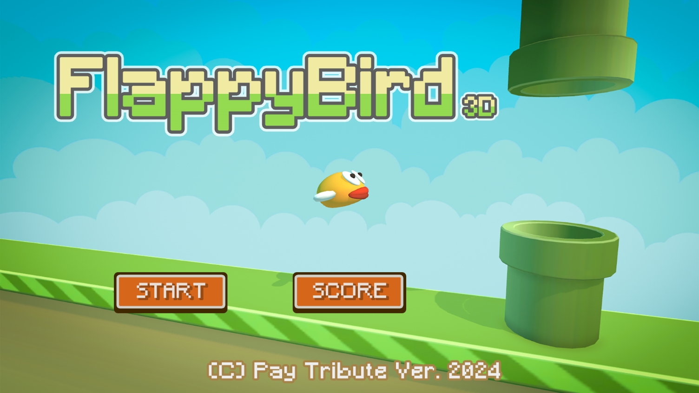
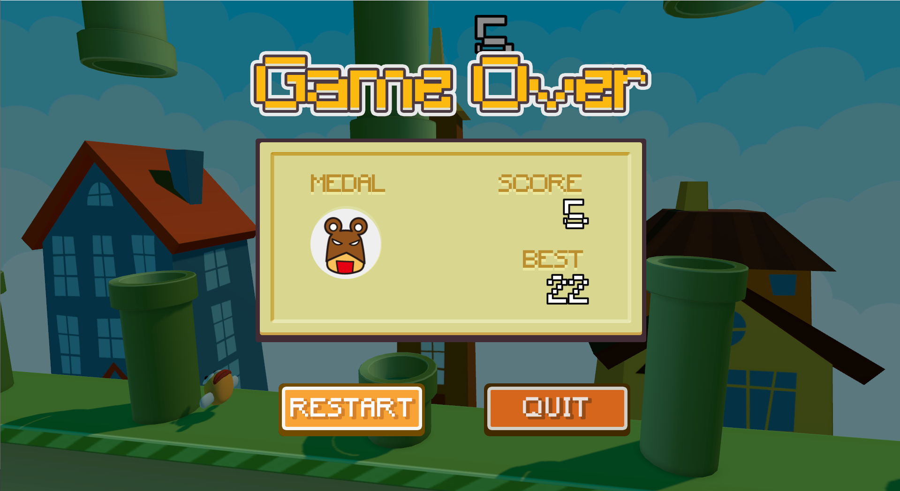
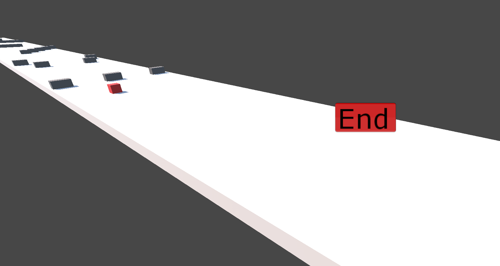
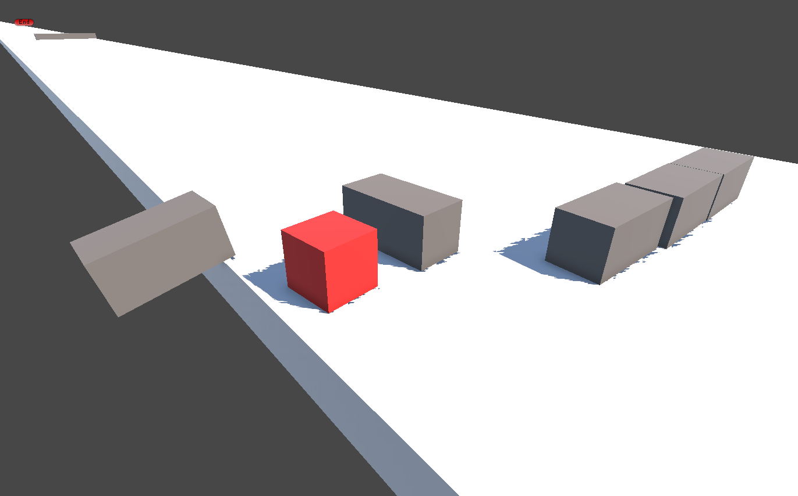

# Web 基本原理與技術 鐵人賽作品展示網站

## 緣起
在輔仁大學資訊工程學系的選修課「Web 基本原理與技術」中，老師要求我們參加 iThome 的鐵人賽。於是我在30天的鐵人賽中初步學會了 Unity 製作了一些小遊戲，最後成功完賽。我希望這個小遊戲可以放到網路上，給互評的同學下載下來體驗，因此特別製作了這個網站。這個網站除了讓大家可以透過連結下載到遊戲以外，也是我寫的第一個有正式用途的網站，在實作後更讓我了解 HTML, CSS 之間的運作關係。

## 成果
我製作了經典的 Flappy Birds 還有 CubeThon。

### Flappy Birds
玩家需要盡可能的通過更多的水管來獲取更高的分數，最高紀錄將會儲存在使用者的本地
- 使用空白鍵操控小鳥上下跳動
- 每當玩家通過一組管道，玩家就會獲得一分
- 當玩家碰到水管避或是碰到地板，遊戲就會結束

  
  

<!-- 遊玩影片：在 GitHub 網頁上編輯此檔，把 videos/Flappy-Bird-3D-demo.MOV 拖到這一行，GitHub 會產生影片網址並顯示成播放器 -->
[到網站觀看遊玩影片!](https://weijayc.github.io/My-games-download-page/#game1)

### CubeThon (方塊馬拉松)
玩家需要操控方塊來閃避障礙，通過三個關卡，就算過關，一關將會比一關困難!
- 使用 `s` 或 `d` 來操控方塊左右
- 一路閃躲障礙物直到通過終點
- 小心不要撞到障礙物！否則遊戲會重新開始

  
  

<!-- 遊玩影片：在 GitHub 網頁上編輯此檔，把 videos/Cubethon-demo.MOV 拖到這一行，GitHub 會產生影片網址並顯示成播放器 -->
[到網站觀看遊玩影片!](https://weijayc.github.io/My-games-download-page/#game2)
